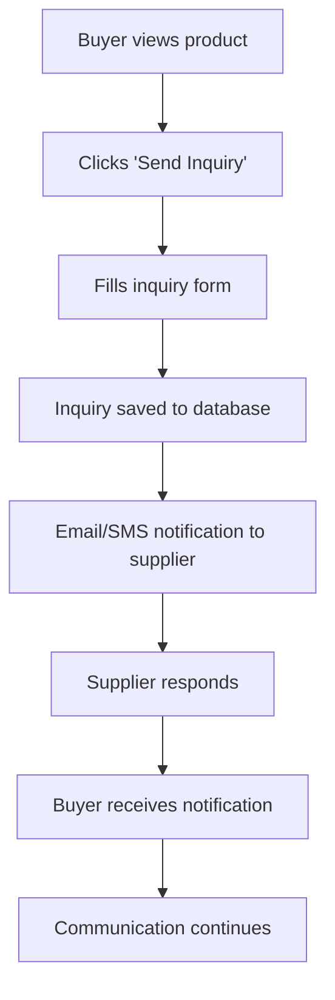

# B2B Marketplace Specific Features Guide

This document outlines the B2B-specific features, challenges, and implementation strategies for the marketplace platform.

## 1. Inquiry System

### Overview
The inquiry system is the core of any B2B marketplace, connecting buyers with suppliers and facilitating business transactions.

### Key Components

#### 1.1 Inquiry Flow


#### 1.2 Inquiry Model Enhancement
```python
class Inquiry(db.Model):
    # Basic fields (from technical architecture)
    id = db.Column(db.Integer, primary_key=True)
    buyer_id = db.Column(db.Integer, db.ForeignKey('user.id'), nullable=False)
    supplier_id = db.Column(db.Integer, db.ForeignKey('user.id'), nullable=False)
    product_id = db.Column(db.Integer, db.ForeignKey('product.id'))
    subject = db.Column(db.String(200), nullable=False)
    message = db.Column(db.Text, nullable=False)
    
    # B2B-specific fields
    quantity = db.Column(db.Integer)
    unit = db.Column(db.String(20))  # kg, pieces, tons, etc.
    required_by = db.Column(db.Date)  # Delivery deadline
    destination_port = db.Column(db.String(100))  # For international trade
    incoterms = db.Column(db.String(20))  # FOB, CIF, EXW, etc.
    budget_range_min = db.Column(db.Float)
    budget_range_max = db.Column(db.Float)
    payment_terms = db.Column(db.String(100))  # T/T, L/C, etc.
    
    # Status and tracking
    status = db.Column(db.Enum('new', 'responded', 'quoted', 'negotiating', 'closed', 'cancelled'), default='new')
    priority = db.Column(db.Enum('low', 'medium', 'high'), default='medium')
    is_urgent = db.Column(db.Boolean, default=False)
    
    # Contact preferences
    contact_preference = db.Column(db.Enum('email', 'phone', 'whatsapp', 'both'), default='email')
    best_time_to_contact = db.Column(db.String(100))
    
    # Timestamps
    created_at = db.Column(db.DateTime, default=datetime.utcnow)
    responded_at = db.Column(db.DateTime)
    closed_at = db.Column(db.DateTime)
```

#### 1.3 Inquiry Response System
```python
class InquiryResponse(db.Model):
    id = db.Column(db.Integer, primary_key=True)
    inquiry_id = db.Column(db.Integer, db.ForeignKey('inquiry.id'), nullable=False)
    sender_id = db.Column(db.Integer, db.ForeignKey('user.id'), nullable=False)
    message = db.Column(db.Text, nullable=False)
    
    # B2B-specific response fields
    quote_price = db.Column(db.Float)
    quote_validity = db.Column(db.Integer)  # Days
    minimum_order = db.Column(db.Integer)
    delivery_time = db.Column(db.Integer)  # Days
    payment_terms = db.Column(db.String(100))
    product_specifications = db.Column(db.Text)  # JSON
    
    # Attachments
    attachments = db.Column(db.Text)  # JSON array of file paths
    
    # Response type
    response_type = db.Column(db.Enum('message', 'quote', 'counter_offer'), default='message')
    
    created_at = db.Column(db.DateTime, default=datetime.utcnow)
```

#### 1.4 Implementation Strategy

**Frontend Components:**
- Inquiry modal with pre-filled product information
- Multi-step inquiry form with validation
- Real-time inquiry status tracking
- File attachment support (documents, specifications)
- Quote comparison interface

**Backend Services:**
- Inquiry routing and notification system
- Automated follow-up reminders
- Inquiry quality scoring
- Spam detection and filtering
- Analytics on inquiry conversion rates

**Notification System:**
- Email notifications with HTML templates
- SMS notifications for urgent inquiries
- WhatsApp integration (optional)
- Push notifications for logged-in users

## 2. Supplier Verification System

### Overview
Building trust is crucial in B2B marketplaces. A robust verification system ensures supplier authenticity and reliability.

### Verification Levels

#### 2.1 Basic Verification (Free)
- Email verification
- Mobile number verification
- Basic business details
- GST number validation

#### 2.2 Business Verification (Paid)
- Document upload (Business registration, GST certificate)
- Address verification
- Bank account verification
- Website verification

#### 2.3 Premium Verification (Premium)
- Physical verification by representative
- Third-party certification verification
- Financial stability check
- Customer reference verification

### Implementation Strategy

#### 2.1 Verification Model
```python
class Verification(db.Model):
    id = db.Column(db.Integer, primary_key=True)
    user_id = db.Column(db.Integer, db.ForeignKey('user.id'), nullable=False)
    verification_type = db.Column(db.Enum('basic', 'business', 'premium'), default='basic')
    
    # Document storage
    documents = db.Column(db.Text)  # JSON array of document paths
    document_status = db.Column(db.Text)  # JSON object with status per document
    
    # Verification status
    status = db.Column(db.Enum('pending', 'in_review', 'verified', 'rejected', 'expired'), default='pending')
    rejection_reason = db.Column(db.Text)
    
    # Verification details
    verified_by = db.Column(db.Integer, db.ForeignKey('user.id'))  # Admin who verified
    verified_at = db.Column(db.DateTime)
    expires_at = db.Column(db.DateTime)
    
    # Verification checklist
    email_verified = db.Column(db.Boolean, default=False)
    mobile_verified = db.Column(db.Boolean, default=False)
    gst_verified = db.Column(db.Boolean, default=False)
    address_verified = db.Column(db.Boolean, default=False)
    website_verified = db.Column(db.Boolean, default=False)
    
    created_at = db.Column(db.DateTime, default=datetime.utcnow)
    updated_at = db.Column(db.DateTime, default=datetime.utcnow, onupdate=datetime.utcnow)
```

#### 2.2 Document Management
```python
class VerificationDocument(db.Model):
    id = db.Column(db.Integer, primary_key=True)
    verification_id = db.Column(db.Integer, db.ForeignKey('verification.id'), nullable=False)
    document_type = db.Column(db.Enum('business_registration', 'gst_certificate', 'address_proof', 'bank_statement', 'pan_card', 'cancelled_cheque'))
    file_path = db.Column(db.String(255), nullable=False)
    file_name = db.Column(db.String(255), nullable=False)
    file_size = db.Column(db.Integer)
    mime_type = db.Column(db.String(100))
    
    # Verification status
    status = db.Column(db.Enum('pending', 'approved', 'rejected'), default='pending')
    rejection_reason = db.Column(db.Text)
    verified_by = db.Column(db.Integer, db.ForeignKey('user.id'))
    verified_at = db.Column(db.DateTime)
    
    uploaded_at = db.Column(db.DateTime, default=datetime.utcnow)
```

#### 2.3 Verification Workflow
1. **Document Upload**: Secure file upload with validation
2. **Automated Checks**: GST validation, format validation
3. **Manual Review**: Admin interface for document verification
4. **Verification Badge**: Display on supplier profile
5. **Expiration**: Time-limited verification with renewal reminders

#### 2.4 Frontend Implementation
- Document upload interface with drag-and-drop
- Real-time document validation
- Progress tracking for verification status
- Verification badge display system
- Admin verification dashboard

## 3. Premium Listings System

### Overview
Premium listings provide suppliers with enhanced visibility and features, generating revenue for the marketplace.

### Premium Features

#### 3.1 Listing Enhancements
- Golden border on product cards
- "Premium" badge on listings
- Priority placement in search results
- Featured in homepage carousel
- More images allowed (10 vs 5)
- Video upload capability
- Detailed specifications display

#### 3.2 Dashboard Features
- Advanced analytics dashboard
- Lead management system
- Competitor analysis
- Market insights
- Bulk product upload
- API access for inventory management

#### 3.3 Communication Features
- Direct messaging with buyers
- Video calling integration
- Product catalog sharing
- Quotation management
- Order tracking

### Implementation Strategy

#### 3.1 Subscription Model
```python
class Subscription(db.Model):
    id = db.Column(db.Integer, primary_key=True)
    user_id = db.Column(db.Integer, db.ForeignKey('user.id'), nullable=False)
    plan_type = db.Column(db.Enum('free', 'silver', 'gold', 'platinum'), default='free')
    
    # Subscription details
    start_date = db.Column(db.DateTime, nullable=False)
    end_date = db.Column(db.DateTime, nullable=False)
    is_active = db.Column(db.Boolean, default=True)
    
    # Payment details
    payment_method = db.Column(db.String(50))
    transaction_id = db.Column(db.String(100))
    amount = db.Column(db.Float)
    currency = db.Column(db.String(3), default='INR')
    
    # Auto-renewal
    auto_renew = db.Column(db.Boolean, default=False)
    
    created_at = db.Column(db.DateTime, default=datetime.utcnow)
    updated_at = db.Column(db.DateTime, default=datetime.utcnow, onupdate=datetime.utcnow)
```

#### 3.2 Feature Allocation
```python
class SubscriptionFeature(db.Model):
    id = db.Column(db.Integer, primary_key=True)
    plan_type = db.Column(db.Enum('free', 'silver', 'gold', 'platinum'), nullable=False)
    feature_name = db.Column(db.String(100), nullable=False)
    feature_value = db.Column(db.String(100))  # Could be number, boolean, or text
    feature_type = db.Column(db.Enum('number', 'boolean', 'text'), nullable=False)
    description = db.Column(db.Text)
```

#### 3.3 Premium Badge System
- Dynamic badge rendering based on subscription
- Badge expiration handling
- Grace period for expired subscriptions
- Upgrade prompts for free users

## 4. Mobile Number Masking

### Overview
Protect supplier privacy while enabling legitimate business connections through controlled contact information revelation.

### Implementation Strategy

#### 4.1 Number Masking Logic
```python
def mask_mobile_number(number, reveal=False):
    """
    Mask mobile number showing only last 4 digits
    """
    if reveal:
        return number
    
    if len(number) >= 4:
        return f"******{number[-4:]}"
    return number
```

#### 4.2 Revelation Conditions
```python
def should_reveal_number(user_id, product_id, inquiry_id):
    """
    Determine if mobile number should be revealed
    """
    # Reveal if user has sent inquiry for this product
    inquiry = Inquiry.query.filter_by(
        buyer_id=user_id,
        product_id=product_id,
        id=inquiry_id
    ).first()
    
    if inquiry and inquiry.status in ['responded', 'quoted', 'negotiating']:
        return True
    
    # Reveal if user is premium member
    user = User.query.get(user_id)
    if user.is_premium and user.premium_expiry > datetime.utcnow():
        return True
    
    return False
```

#### 4.3 Template Filter
```python
@app.template_filter('mask_mobile')
def mask_mobile_filter(number, reveal=False):
    return mask_mobile_number(number, reveal)
```

#### 4.4 Frontend Implementation
- Masked number display: "******9876"
- "Reveal Number" button with conditions
- Number revelation after inquiry submission
- Premium member automatic revelation
- Admin override capability

## 5. Multi-Image Upload System

### Overview
Product visualization is crucial in B2B marketplaces. A robust multi-image system enhances product presentation.

### Implementation Strategy

#### 5.1 Image Model Enhancement
```python
class ProductImage(db.Model):
    id = db.Column(db.Integer, primary_key=True)
    product_id = db.Column(db.Integer, db.ForeignKey('product.id'), nullable=False)
    image_url = db.Column(db.String(255), nullable=False)
    thumbnail_url = db.Column(db.String(255))
    alt_text = db.Column(db.String(200))
    sort_order = db.Column(db.Integer, default=0)
    is_primary = db.Column(db.Boolean, default=False)
    
    # Image metadata
    file_size = db.Column(db.Integer)
    width = db.Column(db.Integer)
    height = db.Column(db.Integer)
    mime_type = db.Column(db.String(100))
    
    # Processing status
    processing_status = db.Column(db.Enum('pending', 'processing', 'completed', 'failed'), default='pending')
    
    created_at = db.Column(db.DateTime, default=datetime.utcnow)
```

#### 5.2 Upload Features
- Drag-and-drop interface
- Multiple file selection
- Image preview before upload
- Progress indicators
- File validation (size, format, dimensions)
- Automatic image optimization
- Watermarking for premium users

#### 5.3 Cloud Integration
```python
class ImageService:
    def __init__(self):
        self.cloudinary_config = {
            'cloud_name': os.getenv('CLOUDINARY_CLOUD_NAME'),
            'api_key': os.getenv('CLOUDINARY_API_KEY'),
            'api_secret': os.getenv('CLOUDINARY_API_SECRET')
        }
    
    def upload_image(self, file, product_id, is_primary=False):
        # Upload to Cloudinary
        # Generate thumbnails
        # Apply watermarks if premium
        # Save to database
        pass
    
    def delete_image(self, image_id):
        # Delete from Cloudinary
        # Remove from database
        pass
    
    def reorder_images(self, product_id, image_order):
        # Update sort order
        pass
```

#### 5.4 Frontend Components
- Image gallery with thumbnails
- Image zoom functionality
- 360-degree view for premium users
- Video upload for premium products
- Image comparison tool

## 6. Advanced Search and Filtering

### Overview
B2B buyers have specific requirements. Advanced search capabilities help them find exactly what they need.

### Search Features

#### 6.1 Search Parameters
- Product name and description
- Category and subcategory
- Location (city, state, country)
- Price range
- Minimum order quantity
- Supplier verification status
- Supplier type (manufacturer, trader, exporter)
- Business type (SME, large enterprise)
- Certification requirements
- Export capabilities

#### 6.2 Search Implementation
```python
class SearchService:
    def search_products(self, query, filters=None, sort_by='relevance', page=1, per_page=20):
        # Build search query
        products = Product.query
        
        # Text search
        if query:
            products = products.filter(
                db.or_(
                    Product.title.ilike(f'%{query}%'),
                    Product.description.ilike(f'%{query}%')
                )
            )
        
        # Apply filters
        if filters:
            if filters.get('category'):
                products = products.filter(Product.category_id == filters['category'])
            if filters.get('location'):
                products = products.join(User).filter(User.city.ilike(f'%{filters["location"]}%'))
            if filters.get('price_min'):
                products = products.filter(Product.price_min >= filters['price_min'])
            if filters.get('price_max'):
                products = products.filter(Product.price_max <= filters['price_max'])
        
        # Apply sorting
        if sort_by == 'price_low':
            products = products.order_by(Product.price_min.asc())
        elif sort_by == 'price_high':
            products = products.order_by(Product.price_min.desc())
        elif sort_by == 'newest':
            products = products.order_by(Product.created_at.desc())
        else:  # relevance
            products = products.order_by(Product.is_featured.desc(), Product.view_count.desc())
        
        return products.paginate(page=page, per_page=per_page)
```

#### 6.3 Search Analytics
- Track search queries
- Analyze search patterns
- Improve search relevance
- Suggest popular searches
- Track conversion rates

## 7. RFQ (Request for Quotation) System

### Overview
RFQ system allows buyers to post requirements and receive multiple quotes from suppliers.

### Implementation Strategy

#### 7.1 RFQ Model
```python
class RFQ(db.Model):
    id = db.Column(db.Integer, primary_key=True)
    buyer_id = db.Column(db.Integer, db.ForeignKey('user.id'), nullable=False)
    title = db.Column(db.String(200), nullable=False)
    description = db.Column(db.Text, nullable=False)
    category_id = db.Column(db.Integer, db.ForeignKey('category.id'))
    
    # RFQ details
    quantity = db.Column(db.Integer)
    unit = db.Column(db.String(20))
    required_by = db.Column(db.Date)
    destination = db.Column(db.String(200))
    
    # Budget and terms
    budget_range_min = db.Column(db.Float)
    budget_range_max = db.Column(db.Float)
    payment_terms = db.Column(db.String(100))
    
    # Status and timeline
    status = db.Column(db.Enum('draft', 'published', 'closed', 'awarded'), default='draft')
    published_at = db.Column(db.DateTime)
    closes_at = db.Column(db.DateTime)
    awarded_at = db.Column(db.DateTime)
    
    # Attachments
    attachments = db.Column(db.Text)  # JSON array of file paths
    
    created_at = db.Column(db.DateTime, default=datetime.utcnow)
    updated_at = db.Column(db.DateTime, default=datetime.utcnow, onupdate=datetime.utcnow)
    
    # Relationships
    quotes = db.relationship('RFQQuote', backref='rfq', lazy='dynamic')
```

#### 7.2 RFQ Quote Model
```python
class RFQQuote(db.Model):
    id = db.Column(db.Integer, primary_key=True)
    rfq_id = db.Column(db.Integer, db.ForeignKey('rfq.id'), nullable=False)
    supplier_id = db.Column(db.Integer, db.ForeignKey('user.id'), nullable=False)
    
    # Quote details
    unit_price = db.Column(db.Float, nullable=False)
    total_price = db.Column(db.Float, nullable=False)
    currency = db.Column(db.String(3), default='INR')
    
    # Terms and conditions
    delivery_time = db.Column(db.Integer)  # Days
    payment_terms = db.Column(db.String(100))
    validity_days = db.Column(db.Integer, default=30)
    
    # Additional information
    message = db.Column(db.Text)
    specifications = db.Column(db.Text)  # JSON
    attachments = db.Column(db.Text)  # JSON array of file paths
    
    # Status
    status = db.Column(db.Enum('submitted', 'shortlisted', 'awarded', 'rejected'), default='submitted')
    
    created_at = db.Column(db.DateTime, default=datetime.utcnow)
    updated_at = db.Column(db.DateTime, default=datetime.utcnow, onupdate=datetime.utcnow)
```

## 8. Analytics and Reporting

### Overview
Comprehensive analytics help both marketplace operators and suppliers make informed decisions.

### Analytics Features

#### 8.1 Supplier Analytics
- Product views and inquiries
- Conversion rates
- Buyer demographics
- Popular products
- Competitor analysis
- Revenue tracking

#### 8.2 Marketplace Analytics
- User registration trends
- Inquiry volume and quality
- Supplier performance
- Category popularity
- Geographic distribution
- Revenue metrics

#### 8.3 Implementation Strategy
```python
class AnalyticsService:
    def track_product_view(self, product_id, user_id=None):
        # Track product view
        pass
    
    def track_inquiry(self, inquiry_id):
        # Track inquiry submission
        pass
    
    def generate_supplier_report(self, supplier_id, start_date, end_date):
        # Generate comprehensive supplier report
        pass
    
    def get_marketplace_metrics(self, start_date, end_date):
        # Get marketplace-wide metrics
        pass
```

## 9. Security Considerations

### Overview
B2B platforms handle sensitive business information and require robust security measures.

### Security Features

#### 9.1 Data Protection
- GDPR compliance
- Data encryption at rest and in transit
- Secure file storage
- Regular security audits
- Penetration testing

#### 9.2 Fraud Prevention
- Document verification
- IP-based fraud detection
- Behavioral analysis
- Suspicious activity monitoring
- User reporting system

#### 9.3 Access Control
- Role-based permissions
- API rate limiting
- Session management
- Multi-factor authentication for admins
- Audit logging

## 10. Scalability Considerations

### Overview
B2B marketplaces need to scale efficiently as business grows.

### Scalability Features

#### 10.1 Database Optimization
- Query optimization
- Database indexing
- Connection pooling
- Read replicas
- Database sharding

#### 10.2 Caching Strategy
- Redis for session storage
- Application-level caching
- CDN for static assets
- Database query caching
- Page caching for static content

#### 10.3 Infrastructure Scaling
- Load balancing
- Auto-scaling
- Microservices architecture
- Container orchestration
- Geographic distribution

This comprehensive guide addresses the unique challenges of B2B marketplaces and provides practical implementation strategies for building a successful platform.