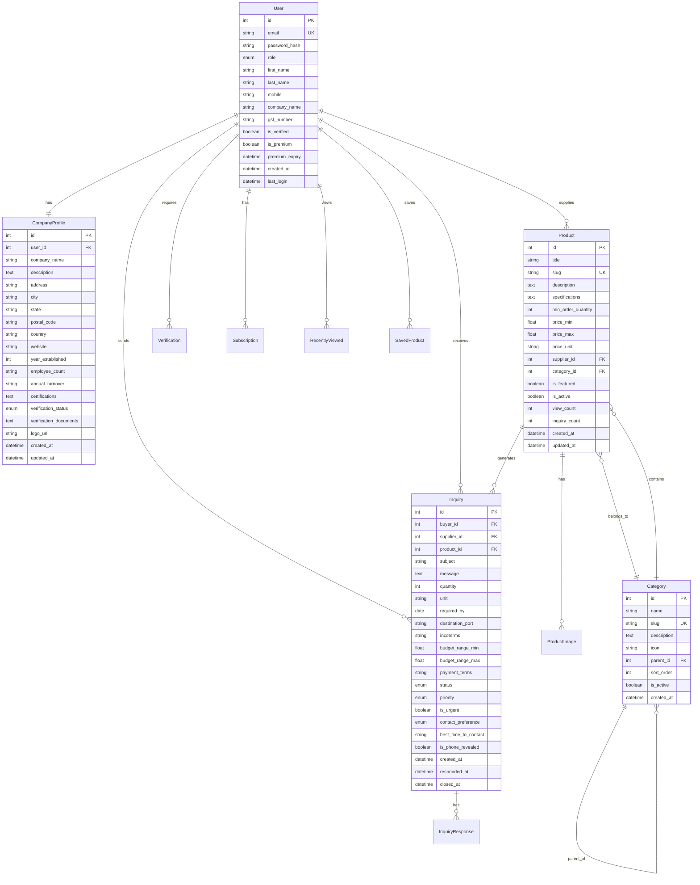

# B2B Marketplace Comprehensive Implementation Plan

## Executive Summary

This document provides a complete blueprint for building a B2B marketplace platform similar to IndiaMART or TradeIndia using Flask + HTMX + Alpine.js + Tailwind CSS. The plan covers all aspects from technical architecture to deployment, with a focus on B2B-specific features and scalable design.

## Project Overview

### Business Objectives
- Create a professional B2B marketplace connecting suppliers and buyers
- Implement trust-building features (verification, reviews, ratings)
- Generate revenue through premium listings and featured placements
- Provide excellent user experience with fast, responsive interface
- Ensure scalability for growing user base and product catalog

### Technical Goals
- Server-side rendered application for optimal SEO
- Minimal JavaScript footprint for fast loading
- Mobile-responsive design for all devices
- Secure and scalable architecture
- Easy maintenance and future enhancements

## Technology Stack Summary

### Backend Technologies
- **Framework**: Flask (Python) - Lightweight, flexible, and extensible
- **Database**: SQLite (development), PostgreSQL (production)
- **ORM**: SQLAlchemy - Powerful database abstraction
- **Authentication**: Flask-Login - Session management and user authentication
- **Forms**: Flask-WTF - Form handling and CSRF protection
- **Migrations**: Flask-Migrate - Database schema management
- **Email**: Flask-Mail - Email notifications
- **Rate Limiting**: Flask-Limiter - API protection
- **Background Jobs**: Celery with Redis - Asynchronous task processing
- **File Storage**: Cloudinary/AWS S3 - Scalable image storage

### Frontend Technologies
- **Templating**: Jinja2 - Server-side rendering
- **Styling**: Tailwind CSS - Utility-first CSS framework
- **Interactivity**: HTMX - Dynamic content without heavy JavaScript
- **Components**: Alpine.js - Lightweight client-side interactivity
- **Icons**: Heroicons - Consistent icon system

### Deployment Technologies
- **WSGI Server**: Gunicorn - Production WSGI server
- **Web Server**: Nginx - Reverse proxy and static file serving
- **Containerization**: Docker - Application containerization
- **Orchestration**: Docker Compose - Multi-container deployment
- **Hosting**: Render/Railway/Fly.io or VPS

## Database Architecture

### Core Models and Relationships



## API and Routes Architecture

### Route Organization

#### Authentication Routes (`/auth`)
- `GET/POST /auth/register/buyer` - Buyer registration
- `GET/POST /auth/register/supplier` - Supplier registration
- `GET/POST /auth/login` - User login
- `POST /auth/logout` - User logout
- `GET/POST /auth/forgot-password` - Password recovery
- `GET/POST /auth/reset-password/<token>` - Password reset

#### Main Application Routes (`/`)
- `GET /` - Homepage with search and featured products
- `GET /search` - Search results with filtering
- `GET /products/<slug>` - Product detail page
- `GET /category/<slug>` - Category page with products
- `GET /suppliers/<username>` - Supplier profile page
- `POST /inquiry/send/<product_id>` - Send inquiry (HTMX)
- `GET/POST /inquiry/<id>` - Inquiry detail and response

#### Dashboard Routes (`/dashboard`)
- `GET /dashboard` - User dashboard
- `GET/POST /dashboard/profile` - Edit user profile
- `GET/POST /dashboard/company` - Company profile management
- `GET /dashboard/products` - Product listing
- `GET/POST /dashboard/products/new` - Add new product
- `GET/POST /dashboard/products/edit/<id>` - Edit product
- `POST /dashboard/products/delete/<id>` - Delete product
- `GET /dashboard/inquiries/sent` - Sent inquiries
- `GET /dashboard/inquiries/received` - Received inquiries
- `GET/POST /dashboard/inquiries/<id>` - Inquiry detail and response
- `GET /dashboard/saved-products` - Saved products

#### Admin Routes (`/admin`)
- `GET /admin` - Admin dashboard
- `GET/POST /admin/users` - User management
- `GET/POST /admin/suppliers/pending` - Supplier verification
- `GET/POST /admin/categories` - Category management
- `GET /admin/products` - Product management
- `GET /admin/inquiries` - Inquiry management

#### API Routes (`/api`)
- `GET /api/search/products` - Live product search
- `GET /api/search/suppliers` - Supplier search
- `GET /api/products/load-more` - Infinite scroll
- `POST /api/products/save/<id>` - Save/unsave product
- `POST /api/products/view/<id>` - Track product view
- `POST /api/inquiry/send` - Send inquiry
- `POST /api/inquiry/respond/<id>` - Respond to inquiry

## Frontend Architecture

### Template Hierarchy

```
base.html
├── auth/
│   ├── login.html
│   ├── register_buyer.html
│   └── register_supplier.html
├── main/
│   ├── homepage.html
│   ├── search_results.html
│   ├── product_detail.html
│   ├── category_page.html
│   └── supplier_profile.html
├── dashboard/
│   ├── dashboard_base.html
│   ├── profile.html
│   ├── company_profile.html
│   ├── products/
│   │   ├── list.html
│   │   ├── form.html
│   │   └── delete_confirm.html
│   ├── inquiries/
│   │   ├── sent.html
│   │   ├── received.html
│   │   └── detail.html
│   └── saved_products.html
├── components/
│   ├── navbar.html
│   ├── footer.html
│   ├── search_bar.html
│   ├── product_card.html
│   ├── inquiry_modal.html
│   ├── pagination.html
│   └── filters.html
└── admin/
    ├── dashboard.html
    ├── users.html
    ├── suppliers.html
    ├── categories.html
    └── inquiries.html
```

### HTMX Integration Points

1. **Live Search**: Real-time product search with debouncing
2. **Infinite Scroll**: Load more products on scroll
3. **Modal Dialogs**: Inquiry forms, confirmations
4. **Dynamic Filtering**: Update results without page reload
5. **Form Submissions**: Instant feedback and validation
6. **Content Loading**: Lazy load sections for performance

### Alpine.js Components

1. **Mobile Navigation**: Responsive menu toggle
2. **Tab Systems**: Product details, specifications
3. **Accordions**: FAQ, product details
4. **Image Galleries**: Product image viewers
5. **Form Validation**: Real-time feedback
6. **Dropdown Menus**: User menu, filters

## Authentication and Authorization

### User Roles and Permissions

1. **Guest** (Unauthenticated)
   - Browse products and categories
   - View supplier profiles
   - Search products
   - Limited product details

2. **Buyer** (Authenticated Buyer)
   - All guest permissions
   - Send inquiries
   - Save products
   - View contact details after inquiry
   - Track order history

3. **Supplier** (Authenticated Supplier)
   - All buyer permissions
   - Manage products
   - Respond to inquiries
   - Update company profile
   - View analytics dashboard

4. **Verified Supplier** (Verified Supplier)
   - All supplier permissions
   - Verification badge
   - Higher search ranking
   - Trust indicators

5. **Premium Supplier** (Paid Supplier)
   - All verified supplier permissions
   - Featured listings
   - Priority placement
   - Advanced analytics
   - Bulk operations

6. **Admin** (Platform Administrator)
   - Full system access
   - User management
   - Content moderation
   - System configuration
   - Analytics and reporting

### Security Measures

1. **Password Security**
   - Bcrypt hashing
   - Minimum password requirements
   - Password strength validation

2. **Session Security**
   - Secure session cookies
   - Session timeout
   - CSRF protection

3. **Input Validation**
   - Form validation with WTForms
   - SQL injection prevention
   - XSS protection

4. **Rate Limiting**
   - Login attempt limiting
   - API endpoint throttling
   - Inquiry submission limits

## B2B-Specific Features Implementation

### 1. Inquiry System

**Core Components:**
- Multi-field inquiry forms with business-specific fields
- Quote management system
- Document attachment support
- Communication thread tracking
- Status workflow management

**Technical Implementation:**
- Real-time notifications via WebSocket or polling
- Email/SMS integration for alerts
- Document storage with Cloudinary
- Spam detection and filtering
- Analytics on inquiry conversion

### 2. Supplier Verification

**Verification Levels:**
- Basic (Email, Mobile, GST verification)
- Business (Document upload, Address verification)
- Premium (Physical verification, Third-party certification)

**Implementation Strategy:**
- Document upload with validation
- Automated verification checks
- Admin review workflow
- Verification badge system
- Expiration and renewal management

### 3. Premium Listings

**Premium Features:**
- Featured placement in search results
- Golden border and badges
- Priority support
- Advanced analytics
- Bulk product upload
- API access

**Monetization Strategy:**
- Subscription-based model
- Tiered pricing (Silver, Gold, Platinum)
- Annual and monthly plans
- Auto-renewal system
- Grace period management

### 4. Mobile Number Masking

**Implementation Approach:**
- Template filters for number masking
- Conditional revelation based on inquiry status
- Premium member exceptions
- Admin override capability
- Analytics on number revelation

### 5. Multi-Image Upload

**Features:**
- Drag-and-drop interface
- Multiple file selection
- Image preview and editing
- Automatic optimization
- Watermarking for premium users
- 360-degree product views

## Implementation Phases and Timeline

### Phase 1: Foundation (Week 1)
**Duration:** 5-7 days
**Objectives:** Establish core infrastructure and basic functionality

**Key Deliverables:**
- Project structure and configuration
- Database models and migrations
- Basic authentication system
- Homepage with search functionality
- Basic product listing

**Success Criteria:**
- Users can register and login
- Basic product browsing works
- Database schema is established
- Development environment is stable

### Phase 2: Core Features (Week 2)
**Duration:** 5-7 days
**Objectives:** Implement essential marketplace functionality

**Key Deliverables:**
- Product management system
- Inquiry system
- User dashboards
- Search and filtering
- Category management

**Success Criteria:**
- Suppliers can add/edit products
- Buyers can send inquiries
- Search functionality works
- Basic dashboards are functional

### Phase 3: Enhanced Features (Week 3)
**Duration:** 5-7 days
**Objectives:** Add advanced interactions and B2B-specific features

**Key Deliverables:**
- HTMX integration for dynamic content
- Alpine.js components
- Supplier verification system
- Mobile number masking
- Multi-image upload

**Success Criteria:**
- Dynamic interactions work smoothly
- Verification system is functional
- Image upload is robust
- User experience is enhanced

### Phase 4: Advanced Features (Week 4)
**Duration:** 5-7 days
**Objectives:** Implement premium features and admin functionality

**Key Deliverables:**
- Premium listings system
- Admin panel
- Email notifications
- Advanced search
- User engagement features

**Success Criteria:**
- Premium features work correctly
- Admin panel is comprehensive
- Notifications are reliable
- Search is powerful and fast

### Phase 5: Production Ready (Week 5)
**Duration:** 5-7 days
**Objectives:** Optimize, secure, and prepare for deployment

**Key Deliverables:**
- Performance optimization
- SEO implementation
- Security hardening
- Testing and QA
- Deployment configuration

**Success Criteria:**
- Performance meets requirements
- Security is robust
- SEO is optimized
- Deployment is ready

## Development Workflow

### Code Organization

1. **Service Layer**: Business logic and data operations
2. **Model Layer**: Database models and relationships
3. **Route Layer**: HTTP request handling and response
4. **Form Layer**: Form validation and processing
5. **Template Layer**: Presentation and UI logic

### Testing Strategy

1. **Unit Tests**: Model and service layer testing
2. **Integration Tests**: Route and API testing
3. **End-to-End Tests**: User workflow testing
4. **Performance Tests**: Load and stress testing
5. **Security Tests**: Vulnerability scanning

### Deployment Strategy

1. **Development**: Local development with SQLite
2. **Staging**: Production-like environment for testing
3. **Production**: Scalable deployment with PostgreSQL
4. **CI/CD**: Automated testing and deployment pipeline

## Risk Management

### Technical Risks

1. **Scalability Issues**
   - **Mitigation**: Proper database indexing, caching strategy
   - **Monitoring**: Performance metrics and alerts

2. **Security Vulnerabilities**
   - **Mitigation**: Regular security audits, dependency updates
   - **Monitoring**: Security scanning, intrusion detection

3. **Data Loss**
   - **Mitigation**: Regular backups, database replication
   - **Monitoring**: Backup verification, recovery testing

### Business Risks

1. **User Adoption**
   - **Mitigation**: User-friendly interface, excellent support
   - **Monitoring**: User analytics, feedback collection

2. **Competition**
   - **Mitigation**: Unique features, superior user experience
   - **Monitoring**: Competitive analysis, market trends

3. **Revenue Generation**
   - **Mitigation**: Multiple revenue streams, value-based pricing
   - **Monitoring**: Revenue analytics, conversion tracking

## Success Metrics

### Technical Metrics
- Page load time < 2 seconds
- 99.9% uptime
- Database query optimization
- Mobile responsiveness score > 90

### Business Metrics
- User registration rate
- Product listing growth
- Inquiry conversion rate
- Premium subscription adoption
- User retention rate

### User Experience Metrics
- User satisfaction score
- Support ticket resolution time
- Feature adoption rate
- Mobile usage percentage

## Future Enhancements

### Phase 6: Advanced Features (Post-Launch)

1. **Mobile Application**
   - Progressive Web App (PWA)
   - Native mobile app
   - Push notifications
   - Offline functionality

2. **Advanced Analytics**
   - AI-powered recommendations
   - Market insights
   - Predictive analytics
   - Custom reports

3. **International Expansion**
   - Multi-language support
   - Multi-currency support
   - Local payment methods
   - Regional compliance

4. **API Ecosystem**
   - Third-party integrations
   - Developer API
   - Webhook system
   - Partner integrations

## Conclusion

This comprehensive implementation plan provides a solid foundation for building a successful B2B marketplace platform. The phased approach ensures manageable development cycles while delivering value to users at each stage.

The architecture is designed to be:
- **Scalable**: Handles growth in users and products
- **Maintainable**: Clean code structure and documentation
- **Secure**: Robust security measures and best practices
- **User-Friendly**: Excellent user experience across devices
- **Business-Ready**: Revenue generation and analytics capabilities

By following this plan and adapting to user feedback, the B2B marketplace will be well-positioned to compete effectively in the market and provide significant value to both buyers and suppliers.